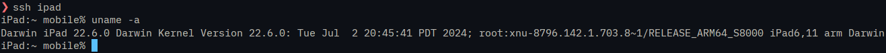

## Cible

**Apple iPad Wi-Fi (5ᵉ génération)**


Identifiant : [`iPad6,11`](https://appledb.dev/device/identifier/iPad6,11.html)  
SoC : [Apple A9](https://fr.wikipedia.org/wiki/Apple_A9) (`APL0898` Samsung ou `APL1022` TSMC)  
Architecture : `arm64`  
Modèle : `A1822`  
Carte mère : `J71sAP`, `J71tAP`  
Couleur : Space Gray  
Sortie : `2017-03-24`  
Arrêt : `2018-03-27`  
OS : iPadOS `16.7.16`  

### Documentation

- https://support.apple.com/fr-fr/111960
- https://support.apple.com/en-us/111960
- https://support.apple.com/fr-fr/docs/ipad/503187
- https://support.apple.com/en-us/docs/ipad/503187
- https://fr.wikipedia.org/wiki/IPad_(5e_g%C3%A9n%C3%A9ration)
- https://en.wikipedia.org/wiki/IPad_(5th_generation)

## Équipement utilisé

- Cordon Lightning ↔ USB-A ;
- Mon bon vieux [ThinkPad P51](/blog/2017-08-31-lenovo-thinkpad-p51) sous Arch Linux.

## Jailbreak

```{figure} /images/2026-11-05_dopamine.png
:alt: Dopamine
```

*J’ai simplement suivi le guide* : [Dopamine (semi-untethered)](https://ios.cfw.guide/get-started/iPad-(5th-generation).html)

## Installation d’OpenSSH et connexion

1. Ouvrir Sileo, chercher OpenSSH, installer puis « Redémarrer l’environnement » depuis Dopamine.

2. Configurer le client :
   ```sh
   $EDITOR ~/.ssh/config
   ```
  
   ```txt
   Host ipad <iPad IP>
       User mobile
   ```

3. Copier sa clé SSH :
   ```sh
   ssh-copy-id -i ~/.ssh/id_ed25519.pub -o PubkeyAuthentication=no -o PreferredAuthentications=password ipad
   ```
   *Utiliser le mot de passe fourni à l’installation de Dopamine.*

4. Vérifier la connexion :
   ```sh
   ssh ipad
   ```
   [](/images/2026-11-05_ipad_ssh.png)


5. *(Optionnel)* Durcissement :  
   *Sur l’iPad*, **après s’être assuré que la connexion par clé fonctionne.**  
   - désactiver l’authentification par mot de passe :
     ```sh
     sudo sed -i 's/#PasswordAuthentication yes/PasswordAuthentication no/' \
     /var/jb/etc/ssh/sshd_config
     ```
   - et recharger sshd :  
     ```sh
     sudo launchctl kickstart -k user/foreground/com.openssh.sshd
     ```
